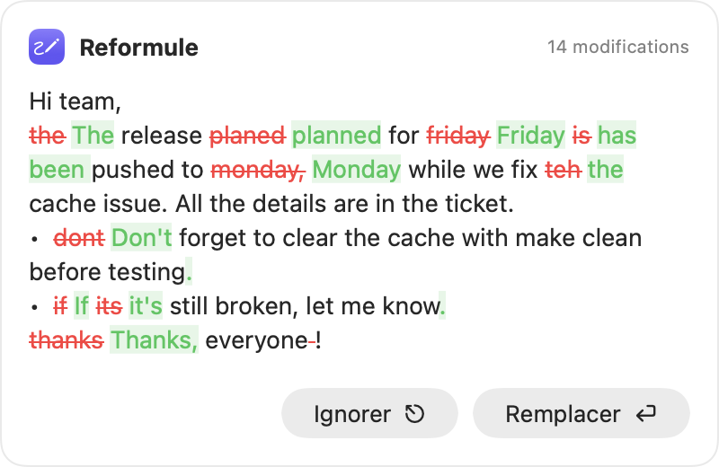
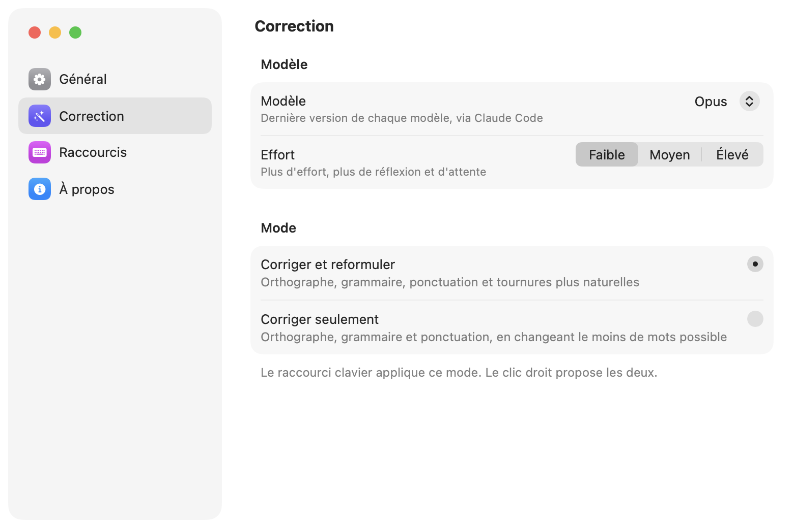

# Reformule

Corrects and rephrases the text of the focused field, in any macOS app, without losing its formatting.

[Website](https://mickadoua.github.io/reformule/) · [Project page on dm-consulting.tech](https://www.dm-consulting.tech/en/open-source/reformule) · [Apache-2.0](LICENSE)

<p>
  
  
</p>

<sub>The app interface is in French for now. Text is corrected in its own language and never translated.</sub>

## What it does

A shortcut (right ⌘ + / by default) copies the selection, or the whole field when nothing is selected, has it corrected by Claude through Claude Code, then shows the changes in a card next to the text: deletions struck through, additions highlighted. Return or Remplacer pastes the corrected text in place; Esc, a click elsewhere or typing dismisses it. Bold, italic, links, code and lists are kept.

The same corrections are in the right-click menu on a selection, under Services: "Reformule : corriger et reformuler" and "Reformule : corriger seulement". They replace the selection directly, without a card or the clipboard, and need no Accessibility permission. If they do not show up, enable them in System Settings > Keyboard > Keyboard Shortcuts > Services > Text.

## Requirements

- macOS 26 on Apple silicon
- [Claude Code](https://code.claude.com) installed and signed in, with `claude` in `~/.local/bin`, `/opt/homebrew/bin` or `/usr/local/bin`
- Xcode Command Line Tools (`xcode-select --install`)

## Download

No download: Reformule is built from source. A signed, notarised app would need a paid Apple Developer account, which this project does not have.

```sh
git clone https://github.com/mickadoua/reformule.git
cd reformule
./build.sh install
open ~/Applications/Reformule.app
```

Then allow Reformule in System Settings > Privacy & Security > Accessibility: it needs it to read the shortcut and send ⌘C / ⌘V. The app is signed ad hoc, so macOS treats it as a new app after every build:

```sh
tccutil reset Accessibility io.github.mickadoua.reformule
```

## Settings

Everything is set in the Settings window, opened from the menu bar icon (Réglages…, ⌘,) or by opening Reformule again from Spotlight or the Finder, which helps when the notch hides the icon:

- **Général** (General): launch at login, Accessibility permission status
- **Correction**: model (Fable, Opus by default, Sonnet or Haiku, each in its latest version through Claude Code aliases), effort (low by default, medium or high), mode (correct and rephrase, or correct only)
- **Raccourcis** (Shortcuts): shortcut recorded from the keyboard, telling left and right keys apart, and a reminder of the right-click Services

## How it works

1. Reformule sends ⌘C. If nothing is copied, it selects the whole field (⌘A) and copies again.
2. It splits the content into blocks (paragraphs, bullets, numbered items) and keeps the structure itself. URLs and code are replaced by tokens the model must copy back.
3. `claude -p` receives the blocks and returns as many corrected blocks, as JSON. The call uses no tools, no MCP servers, no CLAUDE.md and none of the user's hooks.
4. A block whose formatting markers or tokens changed is left as it was.
5. Reformule shows the changes in a card next to the selection, placed from the Accessibility text bounds, or under the pointer when the app does not expose them. On Return it rebuilds the HTML, RTF and plain text and pastes them with ⌘V. The original clipboard is restored either way.

## Limitations

- Content with images, image emoji or tables is not modified.
- Underline, strikethrough and colors are lost.
- Slack and Jira mentions (@someone) get no special handling.
- In VS Code and JetBrains, ⌘C without a selection copies the current line: that line is what gets corrected.
- Apps that replace the context menu, like many Electron apps, do not show Services: only the shortcut works there.

## Testing without the shortcut

```sh
build/Reformule.app/Contents/MacOS/Reformule --pasteboard
```

Processes the clipboard content with the saved settings and writes the result back, without Accessibility.

## Privacy

Text is sent to Anthropic by Claude Code, with the signed-in account, and counts against its subscription or billing.

## License

[Apache-2.0](LICENSE) (replaces MIT). Reformule is a project of [DM Consulting](https://www.dm-consulting.tech).
